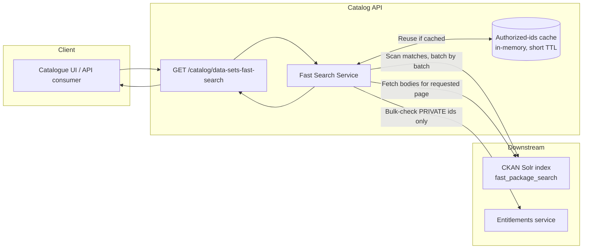
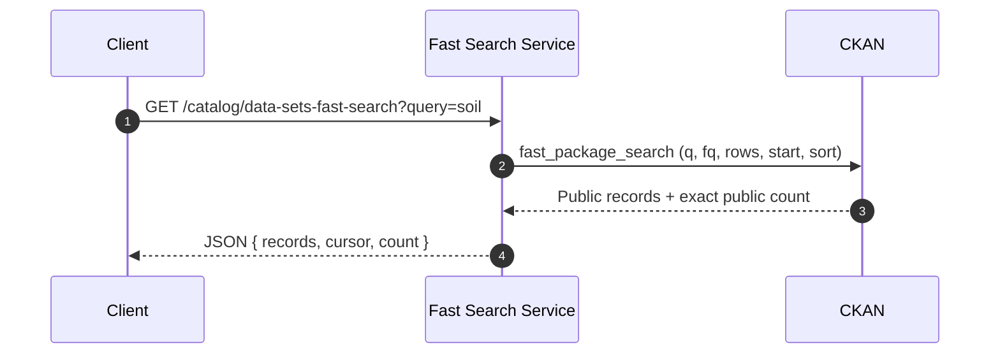
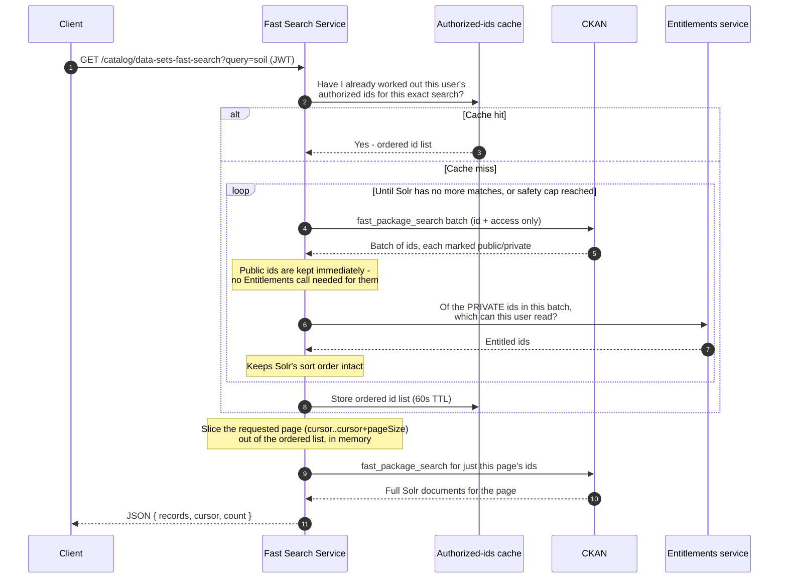

## 1. Fast Search - How Authenticated Fast Search Works

Fast search for **guest-only** made exactly one call to CKAN's `fast_package_search` action, which reads pre-compiled Solr documents directly — no per-record database lookup, no entitlements check. That's what made it "fast": one round trip, and CKAN itself only ever returned public, published records.

The moment a logged-in user needs to see their private records too, that single-call shortcut stops being enough — CKAN's Solr index doesn't know who is asking, only whether a record is `public` or `private`. Something has to decide, per user, which `private` records they're actually allowed to see. That's the Entitlements service's job, same as in `/catalog/data-sets-search`.

---

## 2. What the client sees

```
GET /catalog/data-sets-fast-search?query=<search term>&pageSize=<n>&cursor=<n>
```

Same URL, same query parameters, same response shape as before. The only thing that changes behaviour is **whether the request carries a JWT**:

| Caller | Behaviour |
| --- | --- |
| **Guest** (no JWT) | Unchanged. One Solr call, public records only. |
| **Logged-in user** (JWT present) | New. Private records the user is entitled to are now included, exact match count is returned, and results are still returned quickly on repeated pages. |

Nothing in the request or response *shape* changed — no new parameters, no new fields the client must send. `req.user` (the same JWT the rest of the API already reads) is now read here too.

---

## 3. High-level architecture



| Component | Role |
| --- | --- |
| **Fast Search Service** | New logic (`app/services/catalog-fast-search`). Decides guest vs. authenticated path, runs the scan, owns the cache. |
| **Authorized-ids cache** | New. In-process, per Catalog API instance. Holds the *ordered list of record ids this user is allowed to see for this exact search*, for a short time. |
| **CKAN Solr index** | Same as before — `fast_package_search`, pre-compiled documents, no per-record dictization. |
| **Entitlements service** | Same service `/catalog/data-sets-search` already uses (`searchEntitlementsForResources`), called in bulk. |

---

## 4. End-to-end flow

### Guest — unchanged



One call. Same as before this work.

### Logged-in user — new



### Step by step (authenticated path)

**Step 1 — Is there a user?**
If the request has no JWT, nothing below runs — it's the guest path, unchanged.

**Step 2 — Check the cache**
The cache key is the user's identities + the exact search (text, filters, sort). If this user ran this same search in roughly the last minute, the authorized id list is already known — skip straight to Step 5.

**Step 3 — Scan CKAN in batches, not one page at a time**
Unlike `/catalog/data-sets-search` (which asks CKAN for one page of ids at a time, checks entitlements, and repeats *only if that page came up short*), fast search scans in larger batches (200 ids at a time by default) **once**, all the way to the end of the match set — because the aim isn't to fill one page, it's to know the *whole* authorized result set so pagination and the total count are exact afterwards.

**Step 4 — Only ask Entitlements about private records**
Each batch already tells us, from Solr, which ids are `public` and which are `private`. Public ids need no permission check — they're kept immediately. Only the private ids in that batch go to the Entitlements service, in bulk (same `searchEntitlementsForResources` call `/catalog/data-sets-search` uses). Order is preserved throughout — nothing is re-sorted after entitlement filtering.

**Step 5 — Cache the result**
The full ordered, authorized id list is kept in memory for 60 seconds (configurable), keyed to that specific user + search. The next request for page 2, 3, 4... of the *same* search reuses it instantly instead of repeating Steps 3–4.

**Step 6 — Slice the requested page**
`cursor` and `pageSize` are applied to the (already authorized, already sorted) id list in memory — plain array slicing, no further CKAN or Entitlements calls needed to know *which* records belong on this page.

**Step 7 — Load only that page's records**
One more `fast_package_search` call, filtered to just the handful of ids on this page, to get the actual record bodies to return.

**Step 8 — Return the response**
Same shape as before: `{ records, cursor, count }` — except `count` is now the *exact* number of records this user is authorized to see for this search, not just an estimate.

---

## 5. How this differs from `/catalog/data-sets-search`

| | `/catalog/data-sets-search` | `/catalog/data-sets-fast-search` (authenticated) |
| --- | --- | --- |
| CKAN ID lookup | `package_id_search`, one page at a time, re-fetches if entitlements shrink the page | `fast_package_search`, scans ahead in larger batches until the full authorized set is known |
| Entitlements calls | Every batch of ids, every request, every page | Only on a cache miss; skipped entirely for ids already public |
| Result caching | None — every page request repeats the work | Ordered authorized id list cached for 60s per user+search |
| Record bodies | `package_search` (full CKAN dictization) | `fast_package_search` (pre-compiled Solr documents) |
| Total count returned | Not returned — cursor-only pagination | Returned, and exact |
| Guest behaviour | N/A (always identity-scoped) | Completely unchanged, zero Entitlements involvement |

The net effect: the *first* request for a given search by a given user does a comparable amount of work to `/catalog/data-sets-search` (it has to, since finding "everything this user is allowed to see" is real work). Every *subsequent* page of that same search, within the cache window, is close to free — no CKAN scan, no Entitlements call, just an in-memory slice.

---

## 6. Safety limits (new configuration)

| Setting | Default | Purpose |
| --- | --- | --- |
| `fastSearch.authorizedIdScanBatchSize` | 200 | How many Solr rows are pulled per scan iteration. Larger = fewer round trips, more memory per request. |
| `fastSearch.authorizedIdScanMaxRows` | 20,000 | Hard cap on how many Solr rows one scan will walk before giving up, so one very broad, unfiltered search by an authenticated user can't scan an unbounded number of records. |
| `fastSearch.authorizedIdCacheTtlSeconds` | 60 | How long an authorized id list is reused before being recomputed. |

If a search's matches exceed the safety cap, the scan stops at that point rather than continuing indefinitely — this is a deliberate trade-off to protect the service from a pathological worst case (e.g. a very broad search with a very large authorized/private result set), and is not expected to be hit in normal use.

---

## 7. What did **not** change

- CKAN itself, the Solr schema, and the `fast_package_search` CKAN action — untouched.
- The Entitlements service and its API — untouched, reused as-is.
- The guest path — byte-for-byte the same request/response behaviour as before this work.
- The request and response shape of `/catalog/data-sets-fast-search` — same parameters, same fields.

---

## 8. Summary for stakeholders

- **Fast search now supports logged-in users**, seeing their private records alongside public ones, without losing the performance guest search was built for.
- **The expensive part — figuring out what a user is allowed to see — happens at most once per user per search**, then is reused in memory for a short window while that user pages through results.
- **Public records never touch the Entitlements service.** Only private records need a permission check, keeping that cost proportional to how much private data actually matched, not to the whole catalogue.
- **A safety cap protects the service** from unbounded work on very broad authenticated searches; this is a deliberate, documented trade-off, not an oversight.
- **Nothing about the guest experience changed**, and nothing about `/catalog/data-sets-search` changed — this work is fully isolated to the fast-search endpoint.
